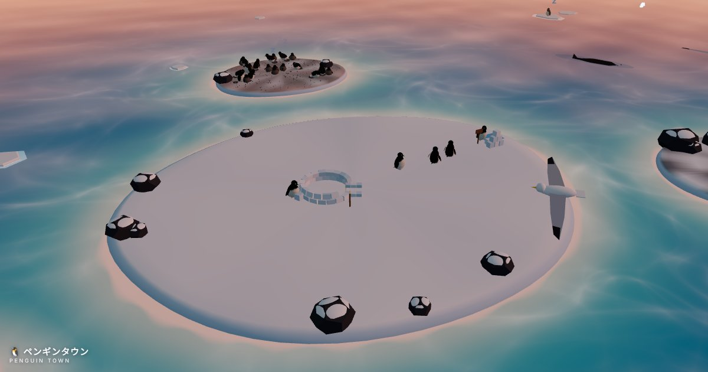

# 🐧 ペンギンタウン 3D / Penguin Town 3D

- 日本語版: https://penguin-island.vercel.app/
- English: https://penguin-island.vercel.app/en/
- プレスキット / Press kit: https://penguin-island.vercel.app/press/ ・ https://penguin-island.vercel.app/press/en/

> **English**: A cozy browser game where you just watch Adélie penguins build a town out of ice blocks. They haul ice, build igloos, houses, a park and a lighthouse, bridge over to new islands, raise chicks in a rookery, and once in a while a humpback whale breaches out at sea. Free, no install. The game opens in English automatically when your browser isn’t set to Japanese, and you can switch languages from the 📋 panel.

ペンギンたちが氷のブロックで街をつくっていくのを、ただ眺めるだけの癒しゲームです。



## あそびかた

- ドラッグでカメラを回転、ピンチ（ホイール）で拡大縮小
- 島をタップすると🐟を投げられます。ペンギンをタップするとプロフィールが出ます
- 🏗 建てる：建てたいものと場所を選んでおねがいできます（橋も作れます）
- 📋：いま作っているものの進み具合
- 💖：推しペンギンの一覧
- 🎬：撮影モード（UIを消して、カメラが自動でいい感じに撮ってくれます）
- 🔇：波の音・ペンギンやカモメの声・オルゴール

## 島のくらし

- アデリーペンギンたちが氷を運び、イグルー、おうち、さかな屋さん、氷のとう、こうえん、とうだい、橋を作ります
- 営巣地の島では、卵を温めたり、ヒナが巣立ったり、小石ドロボーが出たりします
- 流氷の上でのんびりするペンギン、空を飛ぶカモメ、ときどきジャンプするザトウクジラ
- ゲーム内の1日は15分。留守にしている間も、街はゆっくり育ちます（最大6時間分）

## セーブデータについて

進み具合はブラウザの localStorage に保存されます。サーバーには何も送らないので、遊ぶ人ごとに自分だけの島が最初から始まり、ほかの人とデータが混ざることはありません。

## ファイル構成

| パス | 内容 |
| --- | --- |
| `index.html` | 公開用のゲーム本体（ビルド済み・ペンギンのモデル埋め込み） |
| `src/game.template.html` | ゲームのソース（`__GLB__` の部分にモデルが入ります） |
| `assets/penguins.glb` | ペンギン（大人・ヒナ）とクジラの3Dモデル |
| `tools/make_penguin.py` | モデルを作る Blender（bpy）スクリプト |
| `en/index.html` | 英語版（ビルドで自動生成） |
| `tools/build.py` | モデルを埋め込んで `index.html` と `en/index.html` を作るスクリプト |
| `tools/i18n_en.py` | 英語版の翻訳表 |
| `press/` | プレスキット（日本語・英語） |

## ビルド

```bash
# モデルを作り直す場合（Blender の Python モジュールが必要: pip install bpy）
python3 tools/make_penguin.py

# index.html を作る
python3 tools/build.py
```

外部ライブラリは three.js（jsDelivr）と Google Fonts を読み込んでいます。それ以外は静的ファイルだけなので、GitHub Pages や Vercel にそのまま置けます。
